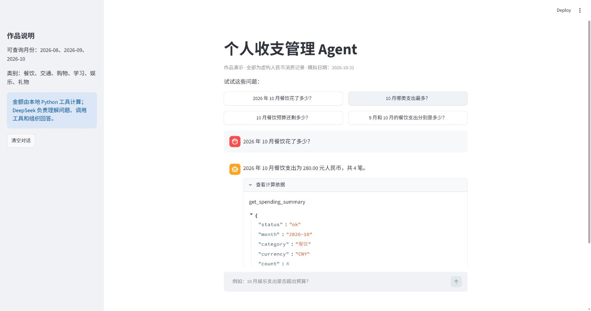

# 个人收支管理 Agent（模拟作品）

一个供 AI 产品实习申请展示的本地 Demo。用户用中文查询虚构账本中的支出和预算；DeepSeek 选择工具，Python 负责计算，聊天页面由 Streamlit 提供。



[下载或观看约两分钟的静音字幕演示 MP4](https://github.com/hwy77-h/budget-agent-demo/raw/refs/heads/main/assets/demo-video.mp4)。视频由本机真实在线交互的截图制作，展示成功查询、预算超支以及缺少月份后的追问与继续对话。

> 所有消费记录和商家均为虚构示例，不连接银行卡、不读取个人账单，不提供投资建议。

## 能做什么

- 查询 2026 年 8–10 月的支出总额、类别支出及笔数。
- 查询分类预算、已用金额和剩余额度；负数表示超支。
- 分别查询两个月的数据，回答跨月对比问题。
- 缺少月份时追问；没有记录或预算时明确说明。

演示数据把“今天”固定为 **2026-10-31**，因此“本月”指 2026 年 10 月。这让录屏和测试可以复现。2026 年 10 月虚构总支出为 **¥2,052.00**，餐饮支出 **¥280.00**，餐饮预算 **¥250.00**，超支 **¥30.00**。

## 在 Windows 上运行

1. 从 [Python 官网](https://www.python.org/downloads/windows/)安装 Python 3.13（64 位）。本机 VS Code 和 Git 已有，但此前 `py` 启动器未找到可用的 Python。
2. 在 PowerShell 进入本项目目录，创建隔离环境并安装依赖：

   ```powershell
   py -3.13 -m venv .venv
   .\.venv\Scripts\python.exe -m pip install -r requirements.txt
   ```

3. 复制 `.env.example` 为 `.env`，只在**本机**把占位内容换成自己的 DeepSeek API 密钥。不要把密钥发给他人，也不要上传 `.env`：

   ```powershell
   Copy-Item .env.example .env
   ```

4. 启动页面：

   ```powershell
   .\.venv\Scripts\python.exe -m streamlit run app.py
   ```

5. 运行无需 API 密钥的本地测试：

   ```powershell
   .\.venv\Scripts\python.exe -m unittest discover -s tests -v
   ```

配置密钥后，可运行 `.\.venv\Scripts\python.exe scripts/evaluate_live.py` 进行九条真实对话测试。原始结果只写入本机的 `.eval_live.json`，已被 Git 忽略；检查后把非敏感的结论填入 `EVALUATION.md`。

项目使用 DeepSeek 官方支持的 OpenAI 兼容接口与工具调用：[首次调用](https://api-docs.deepseek.com/en/) · [工具调用说明](https://api-docs.deepseek.com/guides/tool_calls/)。API 请求会消耗对应账号的额度。建议在 DeepSeek 控制台查看使用量。

## 设计取舍

| 组件 | 责任 |
| --- | --- |
| `data/sample_transactions.csv`、`data/sample_budgets.csv` | 可公开、可复现的虚构数据 |
| `ledger.py` | 校验数据与工具参数，用 `Decimal` 准确计算人民币金额及跨月差额 |
| `agent.py` | 把用户问题发给 DeepSeek，执行被选中的工具，再把结果交回模型 |
| `app.py` | 聊天界面、示例问题和错误提示 |

模型只能选择已定义的三项查询工具，不能执行任意 SQL 或修改账本。若模型没有查询账本却直接报出金额，或报出工具结果中没有的金额，程序会阻止该回答。每次最多进行五轮模型调用，以免错误循环持续消耗额度。第一版不做自动消费分类、真实账单导入、账户登录或在线部署。

每条成功查询可展开“查看计算依据”，检查实际调用的工具和 Python 返回的数据。需求、验收标准与范围见 [PROJECT_BRIEF.md](PROJECT_BRIEF.md)。

## 如何讲这个项目

1. **需求：**普通用户能否不翻表格，直接问出支出和预算状态？
2. **方案：**用 Agent 理解中文问题，用确定性工具计算金额，减少模型编造数字的风险。
3. **验证：**先用固定数据核对金额，再用 [10 条对话测试](EVALUATION.md)检查追问、无数据和错误场景。
4. **改进：**把实测失败案例、原因和修复记录到 `EVALUATION.md`，不要把尚未实测的项目写成已通过。

录屏提纲见 [DEMO_SCRIPT.md](DEMO_SCRIPT.md)，同学试用记录模板见 [FEEDBACK_TEMPLATE.md](FEEDBACK_TEMPLATE.md)。截至 2026-11-01，九条真实 DeepSeek 问答已通过，模拟 API 故障的本地测试也通过；具体记录见 [EVALUATION.md](EVALUATION.md)。两位同学的试用反馈仍待完成。若要重新制作静音视频，可先安装 `video-requirements.txt`，再运行 `scripts/build_demo_video.py`。
